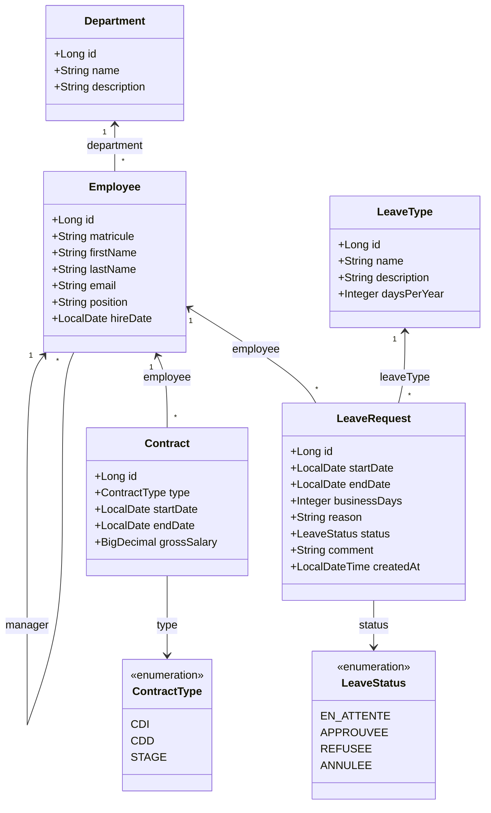

# AtlasRH — API REST de Gestion des Ressources Humaines

API REST d'entreprise développée avec **Spring Boot 3**, **Spring Data JPA**, **PostgreSQL** et **Liquibase**, permettant la gestion complète des départements, des collaborateurs, des contrats et du cycle de vie des congés.

---

## 1. Stack Technique

- **Langage** : Java 17
- **Framework** : Spring Boot
- **Accès aux données** : Spring Data JPA / Hibernate (validation stricte du schéma via Liquibase)
- **Base de données** : PostgreSQL 16 (via Docker Compose)
- **Migrations de schéma** : Liquibase
- **Mapping DTO / Entité** : MapStruct
- **Validation** : Jakarta Bean Validation
- **Documentation API** : SpringDoc OpenAPI 3 / Swagger UI
- **Journalisation** : SLF4J / Logback
- **Tests** : JUnit 5, Mockito, AssertJ, H2 (en mémoire pour les tests)
- **Build tool** : Maven

---

## 2. Diagramme de Classes UML (Modèle Relationnel)



---

## 3. Règles Métier Officielles Appliquées

### Gestion des Employés & Départements (US1 & US2)
- Le nom du département est unique. Un département contenant des collaborateurs ne peut pas être supprimé.
- Le matricule et l'adresse email de l'employé doivent être strictement uniques.
- Un employé ne peut pas être son propre manager (`BusinessRuleException`).
- Un employé ayant des contrats enregistrés, encadrant des collaborateurs ou possédant des demandes de congé ne peut pas être supprimé (`ConflictException`).
- Recherche et consultation paginées (`Pageable`) avec tri et filtres combinés (nom, prénom, département).

### Gestion des Contrats (US3)
- Un seul contrat actif à la fois pour un même collaborateur (détection et interdiction des chevauchements de dates).
- Les contrats de type **CDD** et **STAGE** exigent obligatoirement une date de fin (`endDate`).
- La date de fin doit être supérieure ou égale à la date de début.
- Le salaire brut doit être strictement positif.
- Un contrat en cours ne peut pas être supprimé directement (il doit être résilié d'abord).

### Gestion des Congés & Soldes (US4, US5, US6)
- Les types de congés initiaux sont **Annuel** (22 jours/an) et **Exceptionnel** (10 jours/an).
  > [!NOTE]
  > **Point en attente de confirmation du formateur** : Le brief officiel ne spécifiant pas explicitement les quotas annuels de jours par type de congé, les valeurs par défaut de **22 jours** (Annuel) et **10 jours** (Exceptionnel) ont été retenues à titre indicatif et sont laissées en attente de validation formelle du formateur.
- **Calcul en jours ouvrés** : comptabilise uniquement les jours du lundi au vendredi inclus (les samedis et dimanches sont exclus).
- **Calcul du solde** : 
  $$\text{Solde restant} = \text{jours annuels du type} - \sum \text{jours des demandes APPROUVEE de l'année}$$
- **Répartition entre deux années civiles** : Lorsqu'une demande de congé est à cheval sur deux années (ex. du 29 décembre au 5 janvier), les jours ouvrés sont ventilés avec précision : chaque année civile supporte uniquement les jours ouvrés qui lui correspondent (ex. 3 jours en 2025 et 3 jours en 2026). Le solde de chaque année doit être suffisant lors du dépôt et de la validation.
- Les demandes `EN_ATTENTE`, `REFUSEE` et `ANNULEE` ne sont jamais déduites du solde.
- **Refus automatique** : toute demande dont le nombre de jours ouvrés dépasse le solde disponible est automatiquement rejetée lors du dépôt ou de la validation.
- **Statuts officiels** : `EN_ATTENTE`, `APPROUVEE`, `REFUSEE`, `ANNULEE`.
- **Annulation** : seul l'employé concerné peut annuler sa demande, et uniquement si elle est `EN_ATTENTE`.
- **Validation / Refus Manager** :
  - Une décision n'est possible que sur une demande `EN_ATTENTE`.
  - Le refus exige obligatoirement un motif/commentaire explicatif (`comment`).
  - Interdiction de modifier une demande déjà traitée.

---

## 4. Endpoints de l'API REST & Exemples

### US1 — Départements (`/api/departments`)

| Méthode | Endpoint | Description |
| :--- | :--- | :--- |
| `POST` | `/api/departments` | Créer un département |
| `GET` | `/api/departments` | Lister tous les départements |
| `GET` | `/api/departments/{id}` | Consulter un département par ID |
| `PUT` | `/api/departments/{id}` | Modifier un département |
| `DELETE`| `/api/departments/{id}` | Supprimer un département (si vide) |

<details>
<summary>📋 Exemples de requêtes / réponses</summary>

**Créer un département** — `POST /api/departments`
```json
// Requête
{
  "name": "Informatique",
  "description": "Équipe développement et infrastructure"
}

// Réponse 201
{
  "id": 1,
  "name": "Informatique",
  "description": "Équipe développement et infrastructure"
}
```

**Erreur — nom déjà utilisé** — `409 Conflict`
```json
{
  "status": 409,
  "error": "Conflict",
  "message": "Un département avec le nom 'Informatique' existe déjà",
  "path": "/api/departments"
}
```

**Erreur — département contenant des employés** — `409 Conflict` sur `DELETE`
```json
{
  "status": 409,
  "error": "Conflict",
  "message": "Impossible de supprimer le département 'Informatique' car il contient des employés",
  "path": "/api/departments/1"
}
```
</details>

---

### US2 — Employés (`/api/employees`)

| Méthode | Endpoint | Description |
| :--- | :--- | :--- |
| `POST` | `/api/employees` | Créer un employé |
| `GET` | `/api/employees` | Recherche paginée (`name`, `departmentId`, `page`, `size`, `sortBy`, `sortDir`) |
| `GET` | `/api/employees/{id}` | Consulter un employé par ID |
| `PUT` | `/api/employees/{id}` | Modifier un employé |
| `DELETE`| `/api/employees/{id}` | Supprimer un employé selon règles métier |
| `GET` | `/api/employees/{id}/team` | Consulter l'équipe d'un manager |

<details>
<summary>📋 Exemples de requêtes / réponses</summary>

**Créer un employé** — `POST /api/employees`
```json
// Requête
{
  "matricule": "ATL-042",
  "firstName": "Youssef",
  "lastName": "El Amrani",
  "email": "y.elamrani@atlasrh.ma",
  "position": "Développeur Java",
  "hireDate": "2024-03-01",
  "departmentId": 1,
  "managerId": 3
}

// Réponse 201
{
  "id": 42,
  "matricule": "ATL-042",
  "firstName": "Youssef",
  "lastName": "El Amrani",
  "email": "y.elamrani@atlasrh.ma",
  "position": "Développeur Java",
  "hireDate": "2024-03-01",
  "departmentId": 1,
  "departmentName": "Informatique",
  "managerId": 3,
  "managerFullName": "Karim Bensouda"
}
```

**Recherche paginée** — `GET /api/employees?name=youssef&departmentId=1&page=0&size=10&sortBy=lastName&sortDir=asc`
```json
// Réponse 200
{
  "content": [ { "id": 42, "firstName": "Youssef", "lastName": "El Amrani", "..." : "..." } ],
  "page": 0,
  "size": 10,
  "totalElements": 1,
  "totalPages": 1,
  "first": true,
  "last": true
}
```

**Erreur — employé son propre manager** — `400 Bad Request` sur `PUT`
```json
{
  "status": 400,
  "error": "Bad Request",
  "message": "Un employé ne peut pas être son propre manager",
  "path": "/api/employees/42"
}
```
</details>

---

### US3 — Contrats (`/api`)

| Méthode | Endpoint | Description |
| :--- | :--- | :--- |
| `POST` | `/api/employees/{employeeId}/contracts` | Créer un contrat pour un employé |
| `GET` | `/api/employees/{employeeId}/contracts` | Historique des contrats d'un employé |
| `GET` | `/api/contracts` | Lister tous les contrats (paginé) |
| `GET` | `/api/contracts/{id}` | Consulter un contrat par ID |
| `PUT` | `/api/contracts/{id}` | Modifier un contrat existant |
| `PATCH` | `/api/contracts/{id}/terminate` | Terminer un contrat en cours |
| `DELETE`| `/api/contracts/{id}` | Supprimer un contrat selon règles métier |

<details>
<summary>📋 Exemples de requêtes / réponses</summary>

**Créer un contrat CDI** — `POST /api/employees/42/contracts`
```json
// Requête
{
  "type": "CDI",
  "startDate": "2024-03-01",
  "grossSalary": 8500.00
}

// Réponse 201
{
  "id": 15,
  "employeeId": 42,
  "type": "CDI",
  "startDate": "2024-03-01",
  "endDate": null,
  "grossSalary": 8500.00
}
```

**Créer un contrat CDD** — `POST /api/employees/42/contracts`
```json
// Requête
{
  "type": "CDD",
  "startDate": "2024-01-01",
  "endDate": "2024-12-31",
  "grossSalary": 6000.00
}
```

**Erreur — CDD sans date de fin** — `400 Bad Request`
```json
{
  "status": 400,
  "error": "Bad Request",
  "message": "Un contrat de type CDD doit obligatoirement avoir une date de fin",
  "path": "/api/employees/42/contracts"
}
```

**Erreur — chevauchement de contrats** — `409 Conflict`
```json
{
  "status": 409,
  "error": "Conflict",
  "message": "L'employé possède déjà un contrat qui chevauche la période demandée. Un employé ne peut avoir qu'un seul contrat actif à la fois.",
  "path": "/api/employees/42/contracts"
}
```

**Terminer un contrat** — `PATCH /api/contracts/15/terminate`
```json
// Réponse 200
{
  "id": 15,
  "employeeId": 42,
  "type": "CDI",
  "startDate": "2024-03-01",
  "endDate": "2026-11-09",
  "grossSalary": 8500.00
}
```
</details>

---

### US4 — Validation des congés (Manager)

| Méthode | Endpoint | Description |
| :--- | :--- | :--- |
| `GET` | `/api/managers/{managerId}/leave-requests/pending` | Demandes EN_ATTENTE de l'équipe |
| `PATCH` | `/api/leave-requests/{id}/approve` | Approuver une demande |
| `PATCH` | `/api/leave-requests/{id}/reject` | Refuser avec commentaire obligatoire |

<details>
<summary>📋 Exemples de requêtes / réponses</summary>

**Lister les demandes en attente** — `GET /api/managers/3/leave-requests/pending`
```json
// Réponse 200
[
  {
    "id": 7,
    "employeeId": 42,
    "employeeFullName": "Youssef El Amrani",
    "leaveTypeName": "Annuel",
    "startDate": "2026-12-22",
    "endDate": "2026-12-31",
    "businessDays": 8,
    "reason": "Vacances de fin d'année",
    "status": "EN_ATTENTE",
    "comment": null
  }
]
```

**Approuver une demande** — `PATCH /api/leave-requests/7/approve`
```json
// Réponse 200
{
  "id": 7,
  "status": "APPROUVEE",
  "comment": null,
  "..."  : "..."
}
```

**Refuser une demande** — `PATCH /api/leave-requests/7/reject`
```json
// Requête (commentaire obligatoire)
{
  "comment": "Période critique pour le projet, refus nécessaire"
}

// Réponse 200
{
  "id": 7,
  "status": "REFUSEE",
  "comment": "Période critique pour le projet, refus nécessaire",
  "..." : "..."
}
```

**Erreur — refus sans commentaire** — `400 Bad Request`
```json
{
  "status": 400,
  "error": "Bad Request",
  "message": "Un refus exige obligatoirement un commentaire",
  "path": "/api/leave-requests/7/reject"
}
```
</details>

---

### US5 — Demandes de congé (Employé)

| Méthode | Endpoint | Description |
| :--- | :--- | :--- |
| `POST` | `/api/employees/{employeeId}/leave-requests` | Déposer une demande de congé |
| `GET` | `/api/employees/{employeeId}/leave-requests` | Lister ses demandes (filtre: `status`) |
| `GET` | `/api/leave-requests/{id}` | Consulter une demande |
| `PATCH` | `/api/employees/{employeeId}/leave-requests/{id}/cancel` | Annuler une demande EN_ATTENTE |

<details>
<summary>📋 Exemples de requêtes / réponses</summary>

**Déposer une demande** — `POST /api/employees/42/leave-requests`
```json
// Requête
{
  "leaveTypeId": 1,
  "startDate": "2026-12-22",
  "endDate": "2026-12-31",
  "reason": "Vacances de fin d'année"
}

// Réponse 201
{
  "id": 7,
  "employeeId": 42,
  "employeeFullName": "Youssef El Amrani",
  "leaveTypeId": 1,
  "leaveTypeName": "Annuel",
  "startDate": "2026-12-22",
  "endDate": "2026-12-31",
  "businessDays": 8,
  "reason": "Vacances de fin d'année",
  "status": "EN_ATTENTE",
  "comment": null
}
```

**Lister avec filtre** — `GET /api/employees/42/leave-requests?status=EN_ATTENTE`

**Annuler une demande** — `PATCH /api/employees/42/leave-requests/7/cancel`
```json
// Réponse 200
{
  "id": 7,
  "status": "ANNULEE",
  "..." : "..."
}
```

**Erreur — solde insuffisant** — `400 Bad Request`
```json
{
  "status": 400,
  "error": "Bad Request",
  "message": "Solde insuffisant pour 2026 : 5 jour(s) disponible(s), 8 demandé(s)",
  "path": "/api/employees/42/leave-requests"
}
```

**Erreur — chevauchement** — `409 Conflict`
```json
{
  "status": 409,
  "error": "Conflict",
  "message": "Cette demande chevauche une demande existante",
  "path": "/api/employees/42/leave-requests"
}
```
</details>

---

### US6 — Solde de congés (Employé)

| Méthode | Endpoint | Description |
| :--- | :--- | :--- |
| `GET` | `/api/employees/{employeeId}/leave-balance` | Solde restant par type + ancienneté |
| `GET` | `/api/leave-types` | Lister les types de congés disponibles |

<details>
<summary>📋 Exemples de requêtes / réponses</summary>

**Consulter le solde** — `GET /api/employees/42/leave-balance?year=2026`
```json
// Réponse 200
{
  "employeeId": 42,
  "employeeFullName": "Youssef El Amrani",
  "year": 2026,
  "seniority": "2 an(s) et 8 mois",
  "balances": [
    {
      "leaveTypeId": 1,
      "leaveTypeName": "Annuel",
      "daysPerYear": 22,
      "usedDays": 17,
      "remainingDays": 5
    },
    {
      "leaveTypeId": 2,
      "leaveTypeName": "Exceptionnel",
      "daysPerYear": 10,
      "usedDays": 0,
      "remainingDays": 10
    }
  ]
}
```
</details>

---

## 5. Guide de Démarrage et Installation

### Prérequis
- Java 17 JDK
- Maven 3.8+
- Docker & Docker Compose

### Lancement avec Docker Compose (PostgreSQL)
1. Démarrer le conteneur PostgreSQL :
   ```bash
   docker compose up -d postgres
   ```
   *La base de données sera accessible sur le port hôte `5433` (mappé vers `5432`).*

2. Lancer l'application Spring Boot :
   ```bash
   ./mvnw spring-boot:run
   ```
   *Les migrations Liquibase s'exécutent automatiquement au démarrage et initialisent le schéma complet.*

3. Accéder à l'interface Swagger UI :
   ```
   http://localhost:8080/swagger-ui.html
   ```
