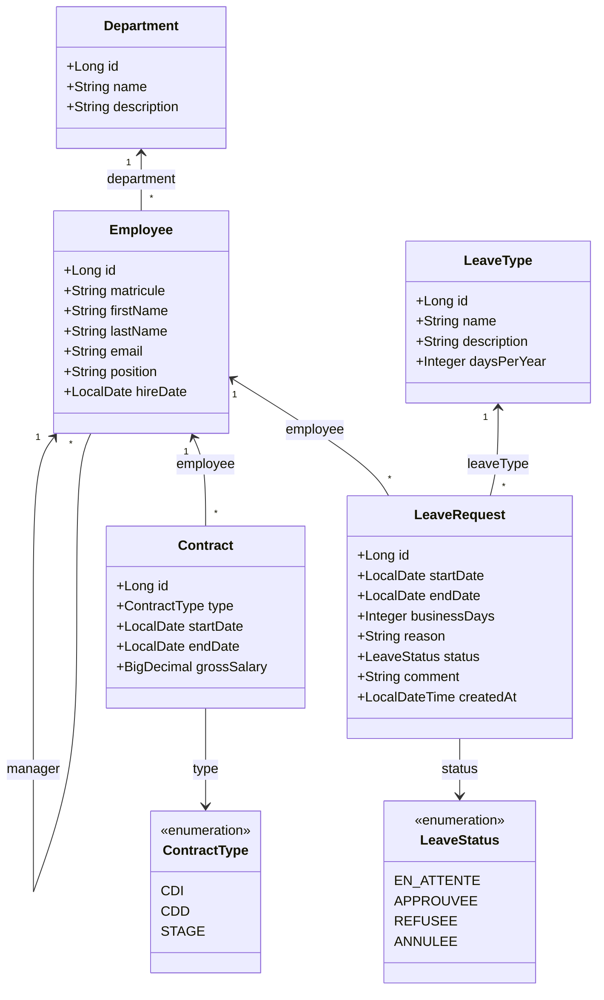

# AtlasRH — API REST de Gestion des Ressources Humaines

API REST d'entreprise développée avec **Spring Boot 3**, **Spring Data JPA**, **PostgreSQL** et **Liquibase**, permettant la gestion complète des départements, des collaborateurs, des contrats et du cycle de vie des congés.

---

## 1. Stack Technique

- **Langage** : Java 17
- **Framework** : Spring Boot
- **Accès aux données** : Spring Data JPA / Hibernate (validation stricte du schéma via Liquibase)
- **Base de données** : PostgreSQL 16 (via Docker Compose)
- **Migrations de schéma** : Liquibase
- **Mapping DTO / Entité** : MapStruct
- **Validation** : Jakarta Bean Validation
- **Documentation API** : SpringDoc OpenAPI 3 / Swagger UI
- **Journalisation** : SLF4J / Logback
- **Tests** : JUnit 5, Mockito, AssertJ, H2 (en mémoire pour les tests)
- **Build tool** : Maven

---

## 2. Diagramme de Classes UML (Modèle Relationnel)



---

## 3. Règles Métier Officielles Appliquées

### Gestion des Employés & Départements (US1 & US2)
- Le nom du département est unique. Un département contenant des collaborateurs ne peut pas être supprimé.
- Le matricule et l'adresse email de l'employé doivent être strictement uniques.
- Un employé ne peut pas être son propre manager (`BusinessRuleException`).
- Un employé ayant des contrats enregistrés, encadrant des collaborateurs ou possédant des demandes de congé ne peut pas être supprimé (`ConflictException`).
- Recherche et consultation paginées (`Pageable`) avec tri et filtres combinés (nom, prénom, département).

### Gestion des Contrats (US3)
- Un seul contrat actif à la fois pour un même collaborateur (détection et interdiction des chevauchements de dates).
- Les contrats de type **CDD** et **STAGE** exigent obligatoirement une date de fin (`endDate`).
- La date de fin doit être supérieure ou égale à la date de début.
- Le salaire brut doit être strictement positif.
- Un contrat en cours ne peut pas être supprimé directement (il doit être résilié d'abord).

### Gestion des Congés & Soldes (US4, US5, US6)
- Les types de congés initiaux sont **Annuel** (22 jours/an) et **Exceptionnel** (10 jours/an).
  > [!NOTE]
  > **Point en attente de confirmation du formateur** : Le brief officiel ne spécifiant pas explicitement les quotas annuels de jours par type de congé, les valeurs par défaut de **22 jours** (Annuel) et **10 jours** (Exceptionnel) ont été retenues à titre indicatif et sont laissées en attente de validation formelle du formateur.
- **Calcul en jours ouvrés** : comptabilise uniquement les jours du lundi au vendredi inclus (les samedis et dimanches sont exclus).
- **Calcul du solde** : 
  $$\text{Solde restant} = \text{jours annuels du type} - \sum \text{jours des demandes APPROUVEE de l'année}$$
- **Répartition entre deux années civiles** : Lorsqu'une demande de congé est à cheval sur deux années (ex. du 29 décembre au 5 janvier), les jours ouvrés sont ventilés avec précision : chaque année civile supporte uniquement les jours ouvrés qui lui correspondent (ex. 3 jours en 2025 et 3 jours en 2026). Le solde de chaque année doit être suffisant lors du dépôt et de la validation.
- Les demandes `EN_ATTENTE`, `REFUSEE` et `ANNULEE` ne sont jamais déduites du solde.
- **Refus automatique** : toute demande dont le nombre de jours ouvrés dépasse le solde disponible est automatiquement rejetée lors du dépôt ou de la validation.
- **Statuts officiels** : `EN_ATTENTE`, `APPROUVEE`, `REFUSEE`, `ANNULEE`.
- **Annulation** : seul l'employé concerné peut annuler sa demande, et uniquement si elle est `EN_ATTENTE`.
- **Validation / Refus Manager** :
  - Une décision n'est possible que sur une demande `EN_ATTENTE`.
  - Le refus exige obligatoirement un motif/commentaire explicatif (`comment`).
  - Interdiction de modifier une demande déjà traitée.

---

## 4. Endpoints de l'API REST

### Départements (`/api/departments`)
| Méthode | Endpoint | Description |
| :--- | :--- | :--- |
| `POST` | `/api/departments` | Créer un département |
| `GET` | `/api/departments` | Lister tous les départements |
| `GET` | `/api/departments/{id}` | Consulter un département par ID |
| `PUT` | `/api/departments/{id}` | Modifier un département |
| `DELETE`| `/api/departments/{id}` | Supprimer un département (si vide) |

### Employés (`/api/employees`)
| Méthode | Endpoint | Description |
| :--- | :--- | :--- |
| `POST` | `/api/employees` | Créer un employé |
| `GET` | `/api/employees` | Recherche paginée (paramètres: `name`, `departmentId`, `page`, `size`, `sortBy`, `sortDir`) |
| `GET` | `/api/employees/{id}` | Consulter un employé par ID |
| `PUT` | `/api/employees/{id}` | Modifier un employé |
| `DELETE`| `/api/employees/{id}` | Supprimer un employé selon règles métier |
| `GET` | `/api/employees/{id}/team` | Consulter l'équipe d'un manager |

### Contrats (`/api`)
| Méthode | Endpoint | Description |
| :--- | :--- | :--- |
| `POST` | `/api/employees/{employeeId}/contracts` | Créer un contrat pour un employé |
| `GET` | `/api/employees/{employeeId}/contracts` | Historique des contrats d'un employé |
| `GET` | `/api/contracts` | Lister tous les contrats (paginé) |
| `GET` | `/api/contracts/{id}` | Consulter un contrat par ID |
| `PUT` | `/api/contracts/{id}` | Modifier un contrat existant |
| `PATCH` | `/api/contracts/{id}/terminate` | Terminer un contrat en cours |
| `DELETE`| `/api/contracts/{id}` | Supprimer un contrat selon règles métier |

### Types de Congés & Soldes (`/api`)
| Méthode | Endpoint | Description |
| :--- | :--- | :--- |
| `GET` | `/api/leave-types` | Lister les types de congés disponibles |
| `GET` | `/api/employees/{employeeId}/leave-balance` | Consulter le solde de congés (paramètre optionnel: `year`) |

### Demandes de Congé (`/api`)
| Méthode | Endpoint | Description |
| :--- | :--- | :--- |
| `POST` | `/api/employees/{employeeId}/leave-requests` | Déposer une demande de congé (US5) |
| `GET` | `/api/employees/{employeeId}/leave-requests` | Lister les demandes d'un employé |
| `GET` | `/api/leave-requests/{id}` | Consulter une demande de congé |
| `PATCH` | `/api/employees/{employeeId}/leave-requests/{id}/cancel` | Annuler sa demande de congé (US5) |
| `GET` | `/api/managers/{managerId}/leave-requests/pending` | Demandes en attente pour le manager (US4) |
| `PATCH` | `/api/leave-requests/{id}/approve` | Approuver une demande de congé (US4) |
| `PATCH` | `/api/leave-requests/{id}/reject` | Refuser une demande avec commentaire obligatoire (US4) |

---

## 5. Guide de Démarrage et Installation

### Prérequis
- Java 17 JDK
- Maven 3.8+
- Docker & Docker Compose

### Lancement avec Docker Compose (PostgreSQL)
1. Démarrer le conteneur PostgreSQL :
   ```bash
   docker compose up -d postgres
   ```
   *La base de données sera accessible sur le port hôte `5433` (mappé vers `5432`).*

2. Lancer l'application Spring Boot :
   ```bash
   ./mvnw spring-boot:run
   ```
   *Les migrations Liquibase s'exécutent automatiquement au démarrage et initialisent le schéma complet.*

3. Accéder à l'interface Swagger UI :
   ```
   http://localhost:8080/swagger-ui.html
   ```

4. Exécuter la suite complète des tests :
   ```bash
   mvn test
   ```
